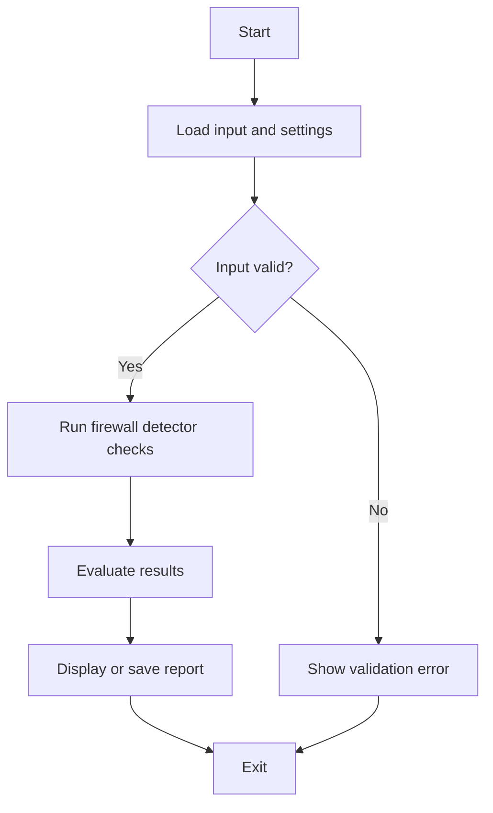

# 🧱 Firewall Detector Tool — #15


## Get this repository

Clone the current project (this repository's canonical GitHub URL), then follow the installation and usage steps below.

```bash
git clone https://github.com/cyberworlduniversity/firewall_detector.git
cd firewall_detector
```

> **Detect Web Application Firewalls (WAF) on any website**
> 
> Part of the **Security Toolkit** by [@hemanathan115](https://github.com/hemanathan115)

---

## 📌 What Is This?

**Firewall Detector** is a Python-based CLI tool that analyzes HTTP responses from websites to determine whether they are protected by a **Web Application Firewall (WAF)** or **CDN-based firewall**.

It works by:
- Sending real HTTP requests to the target
- Matching response headers, cookies, and body content against a database of **14+ WAF signatures**
- Probing with **attack-like payloads** (XSS, SQLi, path traversal, command injection) to observe blocking behavior
- Generating a **confidence-scored report**

---

## ⚙️ Features

| Feature | Description |
|---|---|
| 🔍 Signature Detection | 14+ WAF fingerprints (Cloudflare, AWS WAF, Akamai, etc.) |
| 🚨 Payload Probing | Tests XSS, SQLi, Path Traversal, Command Injection |
| 📶 Confidence Scoring | High / Medium / Low based on evidence weight |
| 📋 Evidence Logging | Shows which headers/cookies/keywords triggered detection |
| 💾 JSON Export | Save full scan results to a report file |
| 🎨 Colored CLI Output | Easy-to-read terminal output with icons |

---

## 🛡️ Detected WAFs / Firewalls

| # | WAF / CDN |
|---|---|
| 1 | ☁️ Cloudflare |
| 2 | 🟠 AWS WAF |
| 3 | 🔵 Akamai |
| 4 | 🟣 Imperva / Incapsula |
| 5 | 🟢 Sucuri |
| 6 | 🔴 Barracuda |
| 7 | ⚫ F5 BIG-IP ASM |
| 8 | 🔷 ModSecurity |
| 9 | 🔶 Wordfence |
| 10 | 🟡 Fastly |
| 11 | ⬜ Varnish Cache |
| 12 | 🟤 DDoS-Guard |
| 13 | 🔸 Fortinet FortiWeb |
| 14 | 🔹 Alibaba Cloud WAF |

---

## 📦 Installation

### 1. Clone the Repository

```bash
git clone https://github.com/cyberworlduniversity/firewall_detector.git
cd firewall_detector
```

### 2. Install Dependencies

```bash
pip install -r requirements.txt
```

---

## 🚀 Usage

### Basic Scan
```bash
python firewall_detector.py -u example.com
```

### Verbose Mode
```bash
python firewall_detector.py -u https://example.com -v
```

### Save JSON Report
```bash
python firewall_detector.py -u example.com --save
```

### Custom Output Filename
```bash
python firewall_detector.py -u example.com --output my_report.json
```

### Set Custom Timeout
```bash
python firewall_detector.py -u example.com --timeout 15 --save
```

---

## 📊 Sample Output

```
╔══════════════════════════════════════════════════════╗
║          🧱  FIREWALL DETECTOR TOOL  🧱              ║
║      Web Application Firewall (WAF) Detection        ║
║              GitHub: hemanathan115                   ║
╚══════════════════════════════════════════════════════╝

[*] Target  : https://example.com
[*] Started : 2024-01-15 12:30:00

[*] Sending baseline request...
[*] Running WAF signature analysis...
[*] Probing with attack-like payloads...
  🚫 BLOCKED [403] /?q=<script>alert(1)</script>
  🚫 BLOCKED [403] /?id=1' OR '1'='1
  🚫 BLOCKED [403] /?file=../../etc/passwd
  🚫 BLOCKED [403] /?cmd=;ls

════════════════════════════════════════════════════════
               📊  SCAN REPORT
════════════════════════════════════════════════════════
  🧱 WAF DETECTED     : YES
  🔍 WAF Name(s)      : Cloudflare
  📶 Confidence       : High
  🌐 Target           : https://example.com
  🚫 Probes Blocked   : 4/4

  📌 Evidence:
     • Header: cf-ray=abc123...
     • Cookie: __cfduid
     • Server: cloudflare
════════════════════════════════════════════════════════
```

---

## 📁 Project Structure

```
firewall-detector/
│
├── firewall_detector.py   # Main tool script
├── requirements.txt       # Python dependencies
└── README.md              # Documentation
```

---

## 🧪 JSON Report Format

```json
{
    "target": "https://example.com",
    "scan_time": "2024-01-15T12:30:00",
    "waf_detected": true,
    "waf_names": ["Cloudflare"],
    "confidence": "High",
    "evidence": [
        "Header: cf-ray=abc123...",
        "Cookie: __cfduid",
        "Server: cloudflare"
    ],
    "response_codes": {
        "baseline": 200
    },
    "probe_results": [
        {"payload": "/?q=<script>alert(1)</script>", "status": "BLOCKED", "code": 403},
        {"payload": "/?id=1' OR '1'='1", "status": "BLOCKED", "code": 403}
    ]
}
```

---

## ⚠️ Disclaimer

> This tool is intended for **educational purposes** and **authorized security testing only**.
> 
> Do **NOT** use this tool against websites or servers you do not own or have explicit permission to test. Unauthorized scanning may be **illegal** in your jurisdiction.
> 
> The author [@hemanathan115](https://github.com/hemanathan115) is not responsible for any misuse of this tool.

---

## 👨‍💻 Author

**Hemanathan**  
GitHub: [@hemanathan115](https://github.com/hemanathan115)  

---

## 📄 License

MIT License — Free to use, modify, and distribute with attribution.

---

⭐ **Star this repo** if you found it useful! Contributions and pull requests are welcome.


## Repository Quick Start

Clone the canonical repository:

```bash
git clone https://github.com/cyberworlduniversity/firewall_detector.git
cd firewall_detector
```

### Requirements and installation

- Python 3.10+ is recommended.
Create an isolated environment and install dependencies:

```bash
python -m venv .venv
# Linux/macOS: source .venv/bin/activate
# Windows PowerShell: .venv\\Scripts\\Activate.ps1
python -m pip install -r requirements.txt
```

### Run

```bash
python firewall_detector.py
```

For scripts that expose command-line options, use `python firewall_detector.py --help` to inspect the options implemented in this version. Begin with sample or non-sensitive input.

### Validate source syntax

```bash
python -m compileall -q .
```

Run only on systems and networks you administer or are authorized to assess.

### Program flow


